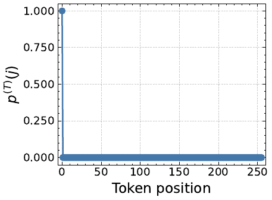
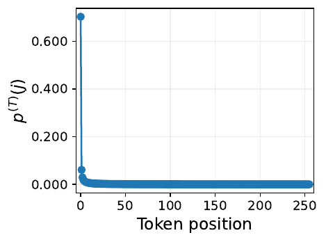
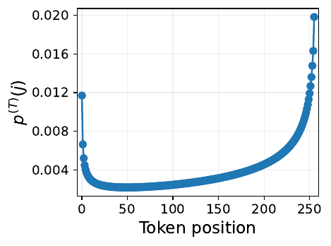
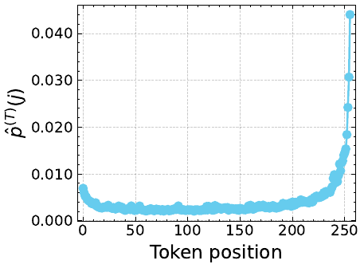
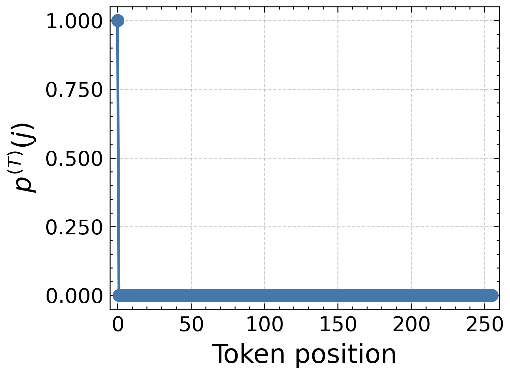
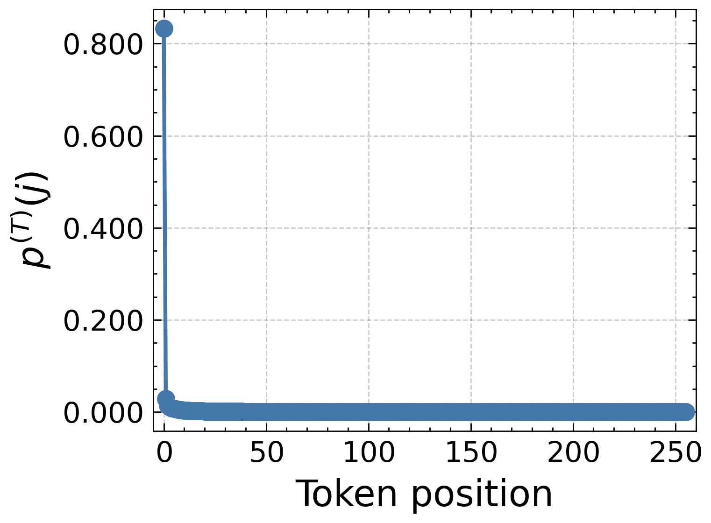
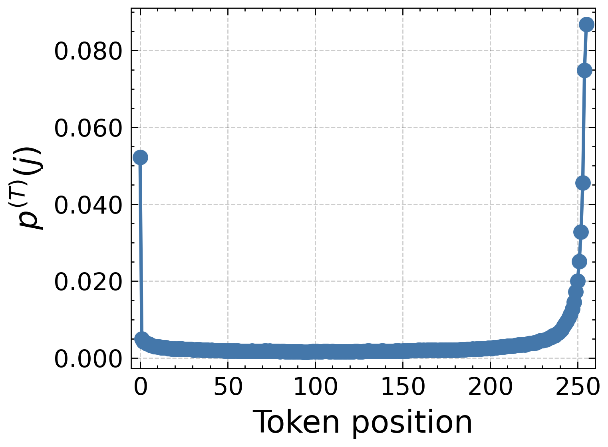
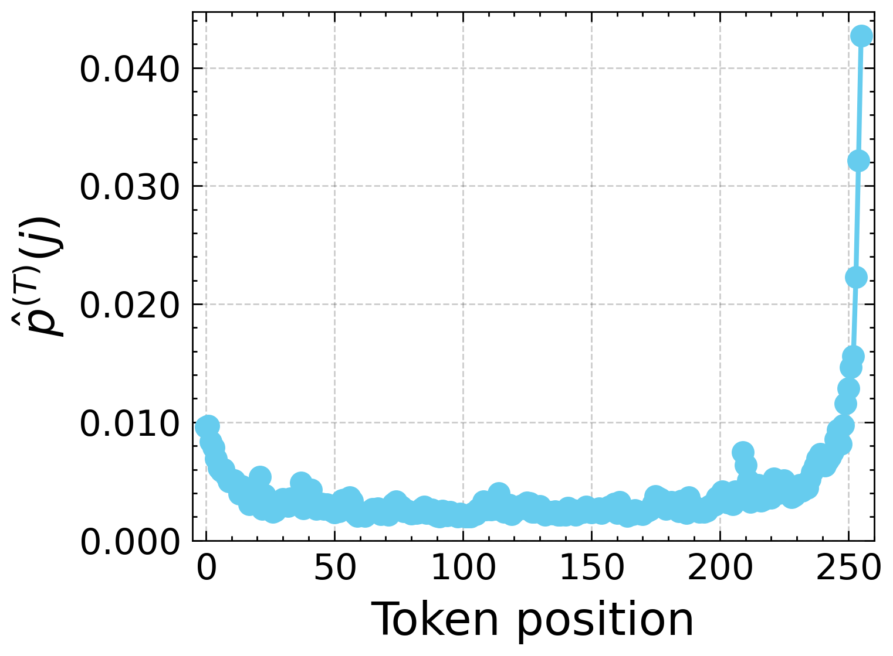

# A Structural Theory of Position Bias in Transformers

[](https://arxiv.org/abs/2602.16837)
[](./LICENSE)

Code for **A Structural Theory of Position Bias in Transformers** by Hanna
Herasimchyk, Robin Labryga, Tomislav Prusina, and Sören Laue.

This repository reproduces the measurements, controlled rollouts, ablations,
tables, and figures reported in the accompanying paper. It covers five ALiBi
models and five RoPE models on FineWeb-Edu, DCLM-Baseline, and Wikipedia at
sequence length 256, together with the 2048-token, blank-out, approximation,
mixing-calibration, monotonicity, and intervention analyses.

## Overview

Causal attention alone drives rollout mass toward early tokens. A fixed
residual weight slows this concentration but does not recover the profiles of
pretrained Transformers. We instead use the layerwise transition

$$
R^{(t)}=(1-\lambda_t)I+\lambda_t A^{(t)},
$$

where the adaptive mixing schedule is measured from forward activations
without using the influence target. Across 30 model-dataset settings, this
residual-aware rollout reduces the mean Wasserstein distance to measured token
influence from 0.62 for attention-only rollout and 0.60 for fixed residual
mixing to 0.09.

The representative profiles below use 256-token FineWeb-Edu sequences.

### Representative ALiBi profile: Falcon-RW-7B

| Attention-only | Fixed residual | Adaptive residual | Measured influence |
| :---: | :---: | :---: | :---: |
|  |  |  |  |

### Representative RoPE profile: Qwen3-8B-Base

| Attention-only | Fixed residual | Adaptive residual | Measured influence |
| :---: | :---: | :---: | :---: |
|  |  |  |  |

## Installation

The environment is managed with [uv](https://docs.astral.sh/uv/):

```bash
uv sync
cp .env.example .env
```

Set `HF_TOKEN` in `.env` if a Hugging Face access token is required in your
environment. Model weights and datasets are read from the Hugging Face Hub and
cached under `HF_HOME`.

## Reproduction interface

`reproduce.py` is the single entry point. Commands accept `--models` and
`--datasets` filters, so the same interface supports a quick verification run,
one paper row, or the complete experiment matrix.

```bash
# Validate the environment and generated experiment configurations.
uv run python reproduce.py check

# Download the public model snapshots and initialize dataset caches.
uv run python reproduce.py download --models all --datasets all

# Run the 256-token measurements and rollouts used in the central tables.
uv run python reproduce.py run main --models all --datasets all

# Run the 2048-token Wikipedia experiment.
uv run python reproduce.py run context --models all

# Run the influence-measurement, approximation, and monotonicity analyses.
uv run python reproduce.py run blankout --models all
uv run python reproduce.py run approximations --models all --datasets all
uv run python reproduce.py run mixing --models all
uv run python reproduce.py run monotonicity --models all --datasets all

# Run the attention-branch intervention on the six paper models.
uv run python reproduce.py run intervention --models all

# Regenerate publication-ready CSV/LaTeX tables and PDF/PNG figures.
uv run python reproduce.py render
```

For the RoPE monotonicity verification, the pipeline averages the unmixed
projection-aware transport kernels and evaluates Assumption 4.1 directly. To
run all RoPE models and all three corpora with 1,000 prompts each:

```bash
uv run python reproduce.py run monotonicity \
  --models qwen2.5-7b,qwen2.5-32b,qwen2.5-72b,qwen3-8b-base,smollm3-3b-base \
  --datasets all --prompts 1000
```

Replace `1000` by `10000` for the larger verification. Results are stored in
prompt-count-specific directories, so the two runs cannot overwrite or
silently reuse one another.

For a small end-to-end verification before a full run:

```bash
uv run python reproduce.py run main \
  --models qwen2.5-7b --datasets fineweb-edu --prompts 2
uv run python reproduce.py render
```

The gradient and RoPE rollout stages write resumable checkpoints and
deterministic run metadata under `results/`. Re-running a completed command
preserves completed outputs and continues incomplete runs. `paper_outputs/`
contains the generated tables and figures.

GPU selection follows the standard `CUDA_VISIBLE_DEVICES` environment
variable. The models up to 8B run on one modern GPU, the 30B and 32B models can
use one high-memory GPU or automatic multi-GPU placement, Qwen2.5-72B uses two
high-memory GPUs, and BLOOM-176B uses four high-memory GPUs. The supplied Slurm
script exposes the same stage, model, and dataset filters:

```bash
sbatch --export=ALL,STAGE=main,MODELS=qwen2.5-7b,DATASETS=fineweb-edu \
  slurm/run_stage.sbatch
```

## Experiment outputs

Each model, corpus, and sequence length uses the directory
`results/<dataset>/<length>/<model>/` with the following subdirectories:

- `attribution/`: corpus-mean next-token probability gradient profile;
- `rollout/`: attention-only, fixed-residual, and adaptive rollout profiles,
  norm-Shapley schedules, kernels, approximation statistics, and W1 metrics;
- `blankout/`: blank-out and matched gradient profiles and metrics;
- `monotonicity.csv`: layerwise and aggregate monotonicity statistics.

Intervention results are stored in `results/intervention/<model>/`. Generated
paper assets are stored in `paper_outputs/tables/` and
`paper_outputs/figures/`.

## Configuration

`config/paper.json` is the authoritative experiment manifest. It records the
public model identifiers, dataset identifiers and revisions, sample counts,
sequence lengths, intervention factors, and ALiBi rollout configurations.
`reproduce.py` materializes complete evaluation YAML files under
`results/run_configs/`.

The main comparison uses normalized one-dimensional Wasserstein distance with
ground metric `|i-j|/(n-1)`. The adaptive mixing coefficient is computed from
the residual and attention branches using the norm-Shapley formula. Gradient
and blank-out profiles are used only for evaluation, not for construction of
the rollout kernels or mixing schedules.
The mixing-coefficient ablation replaces norm-Shapley by the sequence-level
Frobenius relative norm reported in the paper.

## Tests

```bash
uv run pytest -q
```

The test suite checks source-contribution kernels, rollout normalization,
blank-out evaluation, norm-Shapley calibration, and attention-branch
intervention semantics without downloading model weights.

To create a source-only archive:

```bash
uv run python scripts/build_archive.py
```

## Citation

```bibtex
@article{herasimchyk2026structural,
  title   = {A Structural Theory of Position Bias in Transformers},
  author  = {Herasimchyk, Hanna and Labryga, Robin and Prusina, Tomislav and Laue, Sören},
  journal = {arXiv preprint arXiv:2602.16837},
  year    = {2026}
}
```

## External assets

The code downloads the exact public model and dataset repositories listed in
`config/paper.json`. Their licenses and terms are available on the respective
Hugging Face repository pages. No model weights or dataset samples are bundled
with this repository.
